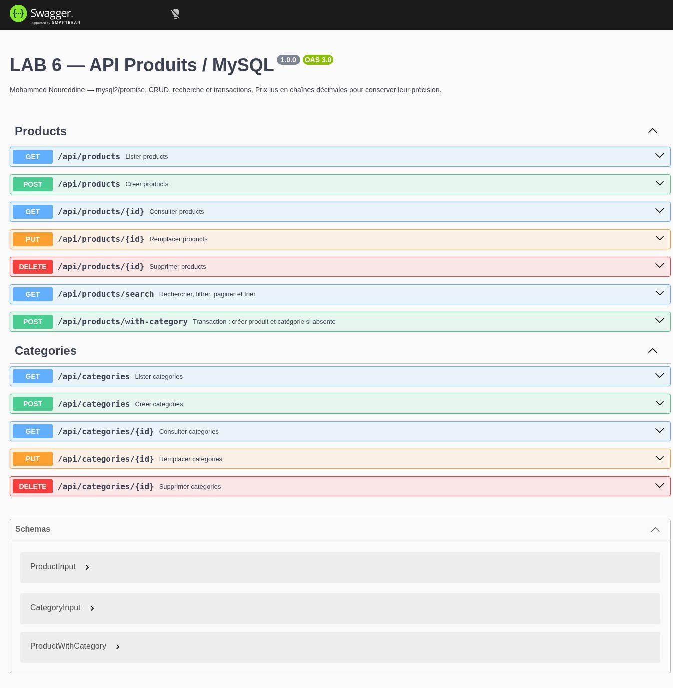
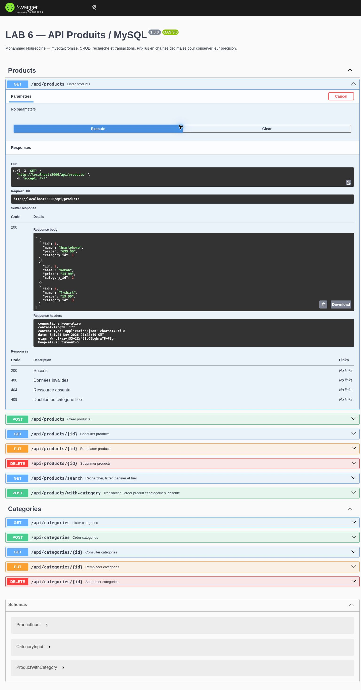
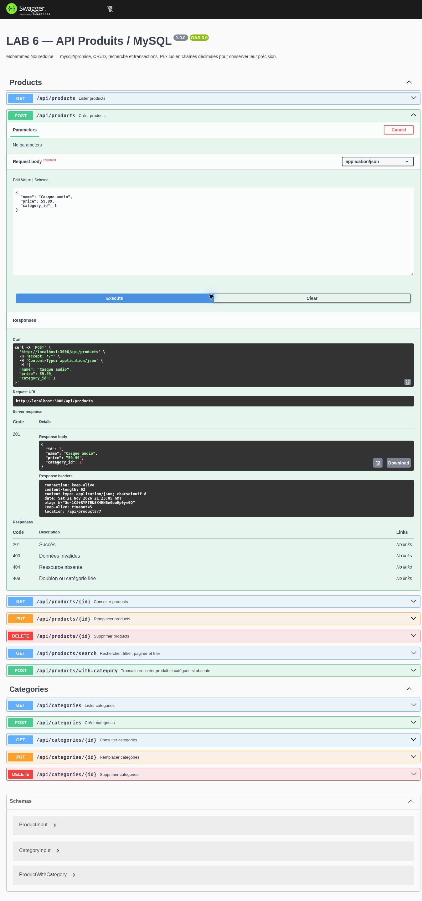
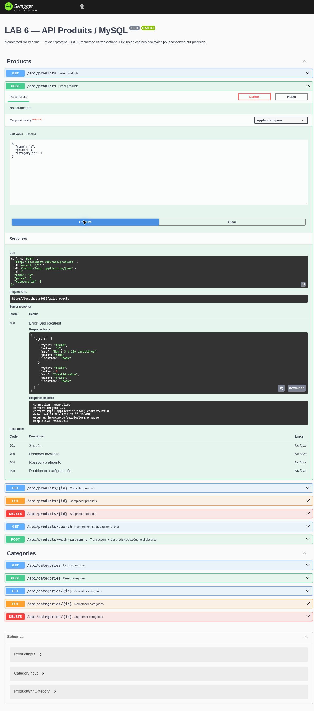
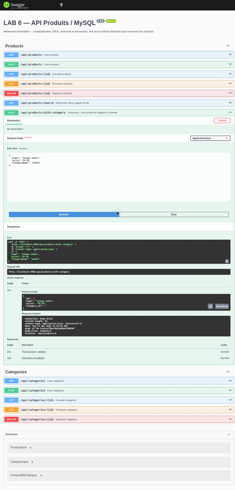
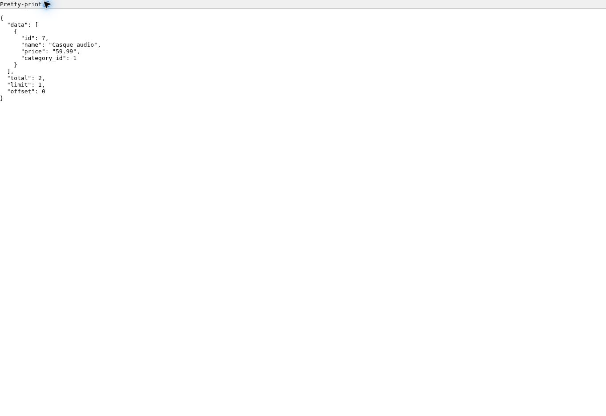
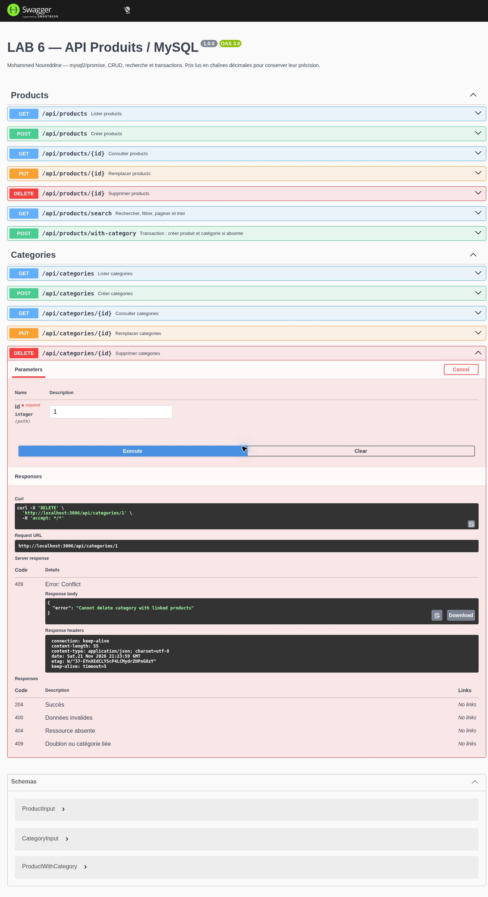
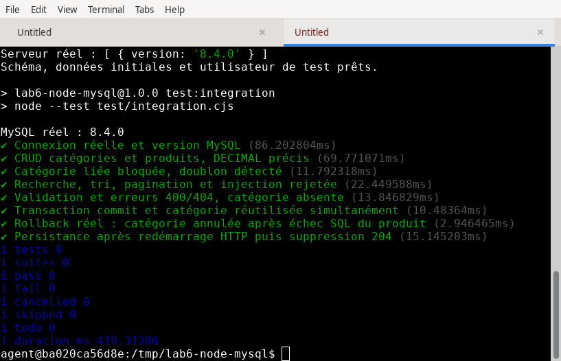

# LAB 6 — Intégration MySQL et gestion asynchrone avec Node.js

API REST de produits et catégories, avec stockage **MySQL**, requêtes paramétrées, `async/await`, transactions, recherche, pagination et documentation Swagger.

## Démarrage sous Windows

Prérequis : Node.js 22 ou supérieur, MySQL 8.4 et MySQL Workbench, Git. MySQL doit être démarré.

1. Cloner puis installer dans PowerShell :

```powershell
git clone https://github.com/medfree2/lab6-node-mysql.git
cd lab6-node-mysql
npm ci
Copy-Item .env.example .env
```

2. Dans MySQL Workbench, ouvrir votre connexion locale. Exécuter `sql/create_database.sql`, puis `sql/seed_data.sql` **une seule fois sur une base vide**. Le deuxième script ajoute 3 catégories et 3 produits. Ne pas le réexécuter pour éviter les doublons.
3. Créer un utilisateur local dédié avec les droits SELECT, INSERT, UPDATE et DELETE sur `lab_product.*`. Renseigner ses identifiants dans `.env`. Adapter le port MySQL si nécessaire, généralement 3306. Le fichier `.env` reste privé et est ignoré par Git.
4. Démarrer :

```powershell
npm start
```

Ouvrir **http://localhost:3006/api-docs/**. Le port de l’API est configurable via `PORT`. Le serveur vérifie la connexion SQL avant d’écouter.

## Organisation

| Dossier | Responsabilité |
|---|---|
| `src/routes` | Chemins HTTP et ordre des middlewares |
| `src/controllers` | Entrées et réponses HTTP |
| `src/services` | Règles métier et transactions |
| `src/repositories` | Requêtes SQL et accès aux données |
| `src/config` | Pool MySQL configurable |
| `src/middlewares` | Validation et gestion centralisée des erreurs |
| `sql` | Schéma relationnel et données de départ |
| `docs` | Spécification OpenAPI |
| `postman` | Collection importable |
| `test` | Tests unitaires et intégration |

Ce lab utilise CommonJS (`require`), comme le support du LAB 6. Les produits contiennent `id`, `name`, `price`, `category_id` ; le schéma de ce lab ne comporte pas de stock.

## Modèle de données

Une catégorie possède plusieurs produits ; un produit possède une catégorie facultative. `category_id` est une clé étrangère avec `ON DELETE SET NULL`. L’API refuse néanmoins la suppression d’une catégorie utilisée avec HTTP 409, conformément à la règle métier. Le service vérifie et verrouille les lignes dans une transaction.

`price` utilise `DECIMAL(10,2)`. Le pilote renvoie ce montant sous forme de chaîne JSON, par exemple `"59.99"`, afin de conserver sa précision. À l’entrée, le prix doit être positif et avoir au plus 2 décimales.

## Routes

| Méthode | Route | Résultat |
|---|---|---|
| GET | `/api/products` | Tous les produits |
| GET | `/api/products/:id` | Un produit ou 404 |
| POST | `/api/products` | Création, 201 et Location |
| PUT | `/api/products/:id` | Remplacement des champs modifiables |
| DELETE | `/api/products/:id` | Suppression, 204 sans corps |
| GET | `/api/products/search` | Recherche, tri et pagination |
| POST | `/api/products/with-category` | Création atomique catégorie et produit |
| GET | `/api/categories` | Toutes les catégories |
| GET | `/api/categories/:id` | Une catégorie ou 404 |
| POST | `/api/categories` | Création, 201 |
| PUT | `/api/categories/:id` | Modification |
| DELETE | `/api/categories/:id` | 204, 404 ou 409 si utilisée |

Exemple de produit :

```json
{"name":"Casque audio","price":59.99,"category_id":1}
```

Exemple de transaction :

```json
{"name":"Casque audio","price":59.99,"categoryName":"Audio"}
```

Recherche : `/api/products/search?name=Casque&minPrice=0&maxPrice=100&page=1&limit=5&sort=price&order=desc`.

Filtres : `name`, `minPrice`, `maxPrice`, `categoryId`. Pagination : `limit` entre 1 et 100 et `offset`, ou `page` à partir de 1. Tri : `id`, `name`, `price`, `category_id`, ordre `asc` ou `desc`. Réponse : `{data,total,limit,offset}`. `total` compte tous les résultats filtrés avant pagination.

## Asynchronisme et transactions

`mysql2/promise` fournit un pool de 10 connexions. Les opérations SQL sont attendues avec `await` ; une erreur remonte au gestionnaire central via `next(error)`.

Pour créer une catégorie et son produit : acquisition d’une connexion, `beginTransaction`, insertion ou réutilisation de catégorie, insertion produit, `commit`. En cas d’échec : `rollback`. La connexion est toujours libérée dans `finally`. Les deux écritures utilisent **la même connexion**. Une contrainte UNIQUE et un upsert évitent les catégories dupliquées lors de requêtes simultanées.

Les valeurs sont liées avec `?`. Les noms de colonnes et l’ordre de tri passent par une liste autorisée ; la pagination est validée avant insertion dans SQL. Le client ne choisit pas l’identifiant à créer. Erreurs : 400 pour données invalides, 404 pour ressource absente, 409 pour conflit, 500 pour erreur interne sans détails SQL exposés.

## Vérification

```powershell
npm test
npm run test:integration
```

**Résultat observé : 2 tests unitaires et 8 tests d’intégration réussis avec un véritable serveur MySQL 8.4.0.** Les tests d’intégration nécessitent la base préparée et `.env` configuré. Ils créent des données préfixées, puis nettoient uniquement leurs propres données. Ils ne réinitialisent pas les données d’exemple.

Scénarios : CRUD, précision DECIMAL, catégorie utilisée, doublon, pagination, paramètres d’injection, validation, JSON incorrect, transaction concurrente, rollback réel provoqué par la contrainte SQL et persistance après redémarrage de l’application HTTP. Le dernier scénario recrée le serveur HTTP dans le processus de test ; il ne redémarre pas MySQL.

Importer `postman/Lab6.postman_collection.json` dans Postman et exécuter dans l’ordre. Les identifiants sont mémorisés automatiquement. La dernière requête conserve une transaction pour inspection ; ses données peuvent ensuite être supprimées via les routes CRUD.

## Captures réelles

Ces captures proviennent de l’API exécutée et de ses résultats réels, sans génération d’images. Le navigateur et le terminal utilisés pour les captures fonctionnent dans un environnement Linux distant ; **ce ne sont pas des captures Windows**. Les instructions ci-dessus sont adaptées à Windows. Les identifiants affichés dépendent des insertions et tests précédents.

### 1. Documentation Swagger



### 2. Lecture des données MySQL — 200



### 3. Création de produit — 201



### 4. Validation refusée — 400



### 5. Transaction catégorie et produit — 201



### 6. Recherche filtrée et paginée



### 7. Catégorie utilisée protégée — 409



### 8. Tests avec MySQL — 8 réussites



## Compléments au support

Swagger et la collection Postman facilitent la démonstration. Le projet corrige également la vérification des catégories utilisées, conserve les bornes de prix égales à zéro et gère les erreurs internes avec HTTP 500. L’API est pédagogique et ne comporte pas d’authentification.

## بالدارجة

هاد التطبيق كيسجل المنتوجات والتصنيفات فقاعدة البيانات، وكيبقاو محفوظين حتى إلا توقف الخادم. كل منتوج يقدر يكون تابع لتصنيف واحد. ملي كنصاوبو تصنيف ومنتوج مع بعضياتهم، يا إما كيتسجلو بجوج، يا إما كتتلغى العملية كاملة إلا وقع خطأ. الاختبارات تأكدو من الإضافة والتعديل والحذف والبحث ومن إلغاء العملية ملي كتفشل.
